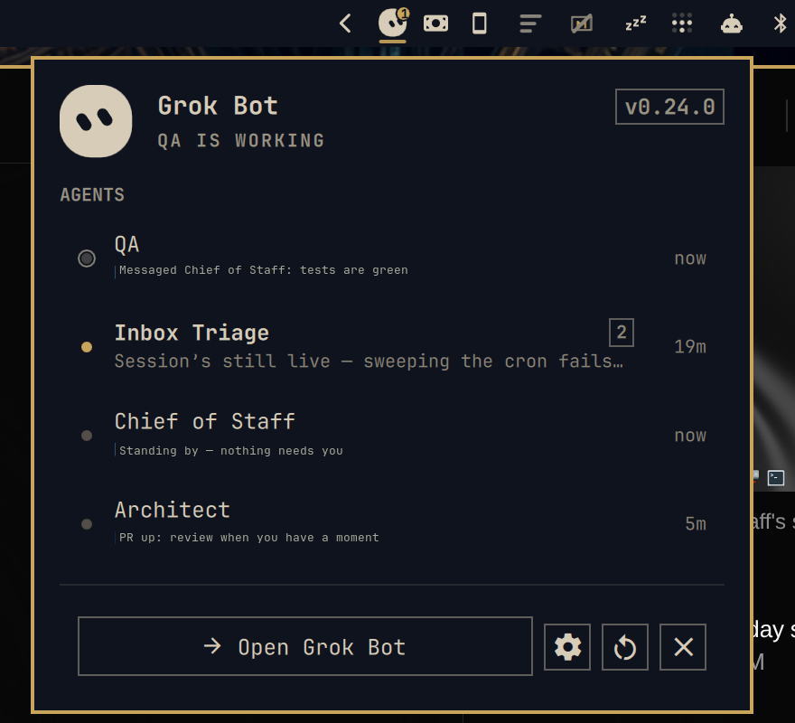

# Grok Bot for Omarchy

Grok Bot's face in the Omarchy bar. It thinks while your agents work, perks
up and names the agent that needs you, and opens a panel of every agent with
what it last said. Unofficial: this plugin is not an xAI or Cursor product.



## What the face tells you

| Mood | Looks like | Means |
| --- | --- | --- |
| Asleep | Dimmed, eyes nearly shut, still | Grok Bot is not running |
| Idle | Eyes open, blinks, glances around | Running, nothing happening |
| Working | Eyes narrowed and scanning, slow breathing | An agent is streaming a reply |
| Unread | Eyes soft, one hop when the news lands, accent badge | An agent finished and you have not looked yet |
| Waiting | Urgent colour, wide-eyed, a nudge every few seconds, badge, and the agent's name beside the face | An agent is blocked on you: a permission, an approval, a question |

The badge counts agents that need you, or agents with unread updates when
none do. The name beside the face is the first agent that needs you, with
`+N` when more are waiting.

## The panel

Left-click the face. The hero shows the app version and a one-line status;
the phrase rotates while everything is quiet. Agents blocked on you come
first under **NEEDS YOU** with the reason Grok Bot recorded; the rest follow
under **AGENTS** with the first line of their last message, an unread count,
and how long ago they were active. Any row opens Grok Bot.

| Key | Action |
| --- | --- |
| `j` `k` | Move between agents and the action row |
| `h` `l` | Walk the action buttons |
| `Enter` | Open Grok Bot (or run the selected action) |
| `o` | Open or launch Grok Bot |
| `s` | Open Grok Bot's settings |
| `r` | Refresh |
| `Shift+R` | Restart Grok Bot |
| `Shift+Q` | Quit Grok Bot |
| `Esc` | Close the panel |

On the bar: left-click opens the panel, right-click opens or launches Grok
Bot, middle-click refreshes.

## How it knows

Nothing here talks to Grok Bot's servers or reads its credentials, and
nothing writes into its directories. The widget reads what the app already
leaves on disk and what the compositor already knows:

- **Agents, unread, waiting:** Grok Bot keeps a client roster under
  `~/.config/Grok Bot/sand-client-persistence/`. Each row carries the
  agent's name, unread count, last message, and an explicit
  `awaitingUserResponse` with a reason when it is blocked on you. The file
  is watched, so the face reacts the moment the app writes it.
- **Working:** the app rewrites an agent's transcript replica while that
  agent streams. An `inotifywait` stream on the directory stamps the agent
  as active on every write; after `workingWindowSec` of silence it counts
  as idle again. This is inferred, so a very slow reply can look idle
  between chunks.
- **Running:** the Grok Bot window through Quickshell's Wayland toplevel
  list, or the session marker the app's main process refreshes while it
  runs.

Names and message previews shown in the panel are yours and never leave
your machine. Control characters are stripped and every label renders as
plain text.

## Install

```bash
omarchy plugin add https://github.com/hmarquez-solutions/omarchy-grok-bot --enable
```

Grok Bot itself comes from the Omarchy repo: `sudo pacman -S grok-bot`.

Requires `inotify-tools` (installed on Omarchy) for the directory watch.

## Settings

Edit the widget in the bar settings or in `~/.config/omarchy/shell.json`:

| Key | Default | Meaning |
| --- | --- | --- |
| `showNameInBar` | `true` | Show the waiting agent's name next to the face |
| `nudgeIntervalSec` | `8` | Seconds between nudges while an agent waits; `0` nudges once |
| `workingWindowSec` | `12` | Seconds after the last transcript write before a working agent counts as idle |
| `hideWhenNotInstalled` | `true` | Collapse the slot when Grok Bot is not installed |

## IPC

```bash
omarchy-shell grok-bot toggle    # open or close the panel
omarchy-shell grok-bot focus     # open or launch Grok Bot
omarchy-shell grok-bot status    # JSON: running, mood, waiting, working, unread, agents
```

## Development

```bash
ln -s "$PWD" ~/.config/omarchy/plugins/io.github.hmarquez-solutions.grok-bot
omarchy plugin enable io.github.hmarquez-solutions.grok-bot right
node tests/model.test.js       # pure logic
tools/gallery/run              # every face mood at three sizes
omarchy-plugin-validate .
```

The shell reloads the plugin on save. Shell logs: `journalctl --user -o cat _COMM=quickshell`.

## License

MIT for this plugin. Grok Bot and its face belong to xAI / Anysphere; the
mark here is a single-colour interpretation drawn in QML.
